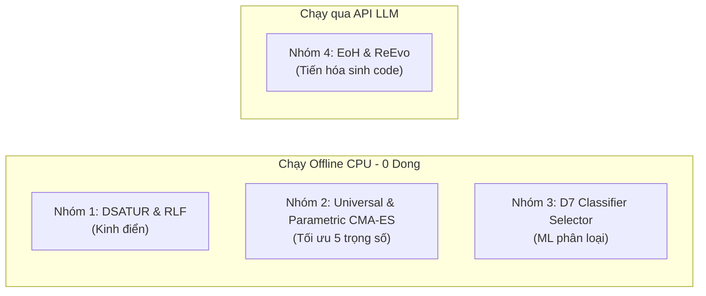

# HƯỚNG DẪN THỰC THI TOÀN BỘ PIPELINE TRÊN LINUX / WSL (LINUX RUNBOOK)

**Tài liệu dành cho:** Thành viên phụ trách chạy mã nguồn trên Server Linux / WSL (Ubuntu)  
**Môi trường:** Linux x86_64 / WSL2 (Ubuntu 20.04 / 22.04 / 24.04), Python 3.11+, Bash shell  
**Quy chuẩn shell:** 100% lệnh Linux Bash (`/`, `\`, `source`, `export`, không dùng lệnh Windows PowerShell).

---

## 1. Thiết Lập Môi Trường Ban Đầu (Setup Environment)

Mở terminal Bash trên Linux / WSL và chạy các lệnh sau:

### Bước 1: Cập nhật hệ thống & Cài đặt gói cơ bản
```bash
sudo apt update && sudo apt install -y python3-pip python3-venv git build-essential
```

### Bước 2: Tạo và Kích hoạt Môi trường ảo (Virtualenv)
```bash
# Tạo môi trường ảo .venv
python3 -m venv .venv

# Kích hoạt môi trường ảo
source .venv/bin/activate
```

### Bước 3: Cài đặt Dependencies cơ sở & PyTorch CUDA
```bash
# 1. Nâng cấp pip
pip install --upgrade pip

# 2. Cài đặt các thư viện cơ bản từ requirements.txt
pip install -r requirements.txt

# 3. Cài đặt PyTorch tương thích CUDA (ví dụ CUDA 12.1):
pip install torch torchvision torchaudio --index-url https://download.pytorch.org/whl/cu121

# 4. Cài đặt các thư viện Fine-tuning & RL:
pip install transformers peft trl bitsandbytes accelerate datasets scipy psutil
```

### Bước 4: Kiểm tra trạng thái GPU
```bash
python3 -c "import torch; print('CUDA Available:', torch.cuda.is_available(), '| Device:', torch.cuda.get_device_name(0) if torch.cuda.is_available() else 'None')"
```
> **Kỳ vọng:** `CUDA Available: True` kèm tên card đồ họa (ví dụ: RTX 3090, A100, T4,...).

---

## 2. HƯỚNG DẪN CHẠY 4 NHÓM BASELINE

Dự án có 4 nhóm baseline so sánh hiệu năng. Tất cả đều chạy được trực tiếp trên Linux/WSL:



---

### Nhóm 1 & 2: Classical Heuristics (DSATUR, RLF) và Parametric CMA-ES Tuning
Hai nhóm này được điều phối chung qua script cổng kiểm soát Phase 1 ([`scripts/run_gate.py`](scripts/run_gate.py)):
- Tự động chạy **DSATUR** (Numba fast path) và **RLF**.
- Chạy **Universal Parametric** (1 bộ trọng số chung tối ưu trên `train_pool`).
- Chạy **Per-Family Parametric CMA-ES** trên tất cả 106 họ đồ thị để tính **Gap A**.

```bash
# Chạy toàn bộ Gate Phase 1 (tận dụng tối đa CPU đa luồng trên Linux)
python3 scripts/run_gate.py
```
* **Thời gian chạy:** Khoảng 3–5 phút trên CPU Linux (16-32 vCPU).
* **Kết quả xuất ra:**
  * `results/gate_per_family.csv`: Bảng điểm chi tiết 106 họ đồ thị.
  * `results/gate_summary.txt`: Báo cáo tóm tắt chỉ số Gap A kèm khoảng tin cậy Bootstrap 95%.

---

### Nhóm 3: Bộ phân loại chọn thuật toán D7 (ML Algorithm Selector)
Bộ chọn thuật toán ([`baselines/d7_classifier.py`](baselines/d7_classifier.py)) học từ 7 chỉ số đặc trưng đồ thị để dự đoán nên dùng DSATUR hay RLF trên từng card mô tả:

```bash
python3 baselines/d7_classifier.py \
    --splits-path data/data_v1_2/splits.json \
    --families-path data/data_v1_1/families_v1_1.json \
    --out-dir runs/baselines/d7
```
* **Thời gian chạy:** ~10 giây (dùng thuần thuật toán tối ưu lồi L-BFGS-B & Decision Tree không phụ thuộc sklearn).
* **Kết quả xuất ra:** `runs/baselines/d7/summary.md` (Độ chính xác và điểm Regret trên từng tập chia `val`, `test_interp`, `test_extrap`, `test_comp`, `heldout_type`).

---

### Nhóm 4: Tiến hóa sinh code bằng LLM (EoH & ReEvo)
Nhóm này dùng LLM (DeepSeek / Gemini / OpenAI) để tự động viết và tiến hóa hàm `priority(adj, colors, sat, deg, uncolored_deg)` qua nhiều thế hệ.

#### Bước A: Thiết lập API Key trên Linux Terminal
```bash
# Thiết lập API Key (không bao giờ commit key vào git)
export DEEPSEEK_API_KEY="your_api_key_here"
# Hoặc nếu dùng Gemini:
export GEMINI_API_KEY="your_api_key_here"
```

#### Bước B: Chạy thử chế độ Mock (Kiểm tra pipeline mất 3 giây, tốn $0.00)
```bash
# Chạy thử EoH Mock:
python3 baselines/run_eoh.py --family ba_m12_n200-300 --budget 5 --mock

# Chạy thử ReEvo Mock:
python3 baselines/run_reevo.py --family ba_m12_n200-300 --budget 5 --mock
```

#### Bước C: Chạy tiến hóa thật trên GPU/Server Linux (Production Mode)
Chọn 3-5 họ đồ thị tiêu biểu để tiến hóa (ví dụ: `ba_m12_n200-300`, `ws_k10_p0.1_n100-200`, `er_p0.15_n200-300`):

```bash
# 1. Chạy Evolution of Heuristics (EoH):
python3 baselines/run_eoh.py \
    --family ba_m12_n200-300 \
    --budget 30 \
    --model deepseek-chat \
    --out-dir runs/baselines/eoh

# 2. Chạy Reflective Evolution (ReEvo):
python3 baselines/run_reevo.py \
    --family ba_m12_n200-300 \
    --budget 30 \
    --model deepseek-chat \
    --out-dir runs/baselines/reevo
```
* **Chi phí:** Khoảng $0.05 – $0.15 cho mỗi họ đồ thị (với budget 30-50 calls).
* **Kết quả xuất ra:** 
  * `runs/baselines/eoh/<family>/summary.json`: Chứa hàm Python `priority` tối ưu nhất tìm được, số màu đạt được trên tập test, và lịch sử tiến hóa.

---

## 3. HƯỚNG DẪN HUẤN LUYỆN HAI GIAI ĐOẠN (SFT LoRA & RL GRPO)

Đây là pipeline chính của bài báo ("Distill, then Sharpen"):

### GIAI ĐOẠN 1: Huấn luyện Chưng cất (SFT LoRA)

#### A. Kiểm tra nhanh bằng Mock (2 giây trên CPU):
```bash
python3 train/train_sft.py --mock
```

#### B. Huấn luyện thật trên GPU Linux (Production SFT):
```bash
python3 train/train_sft.py \
    --train-path data/sft/train.jsonl \
    --val-path data/sft/val.jsonl \
    --output-dir runs/sft/qwen_lora_v1 \
    --model-name Qwen/Qwen2.5-Coder-7B-Instruct \
    --epochs 2 \
    --lr 1e-4 \
    --batch-size 4
```
* **Thời gian hoàn thành:** ~15–20 phút trên GPU Linux (RTX 3090, 4090, A100).
* **Checkpoint LoRA:** `runs/sft/qwen_lora_v1/final_adapter/` (~80 MB).

---

### GIAI ĐOẠN 2: Huấn luyện Mài sắc (RL GRPO)

Nạp trực tiếp checkpoint SFT vừa huấn luyện để mô hình tự sinh code và nhận thưởng từ Sandbox:

#### A. Kiểm tra nhanh bằng Mock (5 giây trên CPU):
```bash
python3 train/train_grpo.py --mock --steps 2
```

#### B. Huấn luyện thật trên GPU Linux (Production GRPO):
```bash
python3 train/train_grpo.py \
    --arm A3 \
    --sft-checkpoint runs/sft/qwen_lora_v1/final_adapter \
    --output-dir runs/grpo/A3/seed_42 \
    --steps 100 \
    --group-size 8
```
* **Đặc tính kỹ thuật trên Linux:**
  * Bộ nạp 4-bit QLoRA (`BitsAndBytesConfig`) chỉ chiếm ~6 GB VRAM.
  * Độc lập dữ liệu: Chỉ bốc họ đồ thị từ `train_pool` (seeds 100000-199999), không chạm vào tập thi.
  * Masking prompt tokens: Chỉ cập nhật gradient trên token code do mô hình tự sinh ra.
* **Thời gian hoàn thành:** ~20–30 phút cho 100 steps.
* **Mô hình hoàn thiện:** `runs/grpo/A3/seed_42/final_policy/`.

---

## 4. ĐÁNH GIÁ MÔ HÌNH VÀ TỔNG HỢP KẾT QUẢ (EVALUATION)

Sau khi huấn luyện xong mô hình SFT và GRPO, thực hiện đánh giá độc lập trên tập kiểm thử nội suy (`test_interp`) và ngoại suy:

```bash
# 1. Đánh giá mô hình SFT (Arm A1):
python3 eval/eval_model.py \
    --backend hf \
    --model-name runs/sft/qwen_lora_v1/final_adapter \
    --split test_interp \
    --k 8 --n-samples 8 \
    --run-id eval_a1_sft

# 2. Đánh giá mô hình sau mài sắc GRPO (Arm A3 - Mô hình cốt lõi):
python3 eval/eval_model.py \
    --backend hf \
    --model-name runs/grpo/A3/seed_42/final_policy \
    --split test_interp \
    --k 8 --n-samples 8 \
    --run-id eval_a3_grpo
```

---

## 5. LƯU Ý KHI CHẠY TRÊN WSL / LINUX SERVER

1. **Không tắt session khi ngắt kết nối SSH:**
   - Dùng `tmux` hoặc `screen` để tiến trình không bị dừng khi đóng cửa sổ terminal:
     ```bash
     # Tạo session mới:
     tmux new -s training
     # (Chạy lệnh python tại đây)
     # Rời session (detach): Bấm Ctrl+B rồi bấm D
     # Quay lại session:
     tmux attach -t training
     ```
2. **Theo dõi tài nguyên GPU trên Linux:**
   ```bash
   watch -n 1 nvidia-smi
   ```
3. **Phân quyền thực thi script (nếu cần):**
   ```bash
   chmod +x scripts/*.py baselines/*.py train/*.py
   ```
