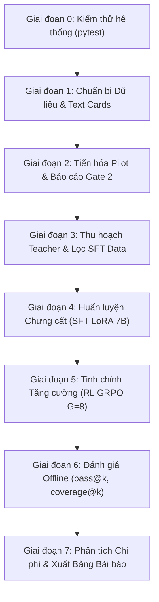

# HƯỚNG DẪN CHẠY FULL PIPELINE (PIPELINE EXECUTION GUIDE)
**Dự án:** *Distill, then Sharpen: Amortizing Evolutionary Heuristic Search into a Family-Conditioned Code LLM*  
**Mục tiêu:** Xây dựng mô hình 7B Code LLM sinh hàm ưu tiên tô màu đồ thị (priority function) trong 1 lần gọi (one-shot), có điều kiện hóa theo text card mô tả họ đồ thị, loại bỏ hoàn toàn tìm kiếm tiến hóa tốn kém khi triển khai.

---

## MỤC LỤC
1. [Yêu cầu Môi trường & Cài đặt](#1-yêu-cầu-môi-trường--cài-đặt)
2. [Thiết lập API Key & Chế độ Chi phí (0đ vs Billed)](#2-thiết-lập-api-key--chế-độ-chi-phí)
3. [Quy tắc Bất biến (Frozen Files & Invariants)](#3-quy-tắc-bất-biến-frozen-files--invariants)
4. [Lộ trình Thực thi Từng Bước (End-to-End Pipeline)](#4-lộ-trình-thực-thi-từng-bước)
   - [Giai đoạn 0: Kiểm thử Hệ thống (System Health Check)](#giai-đoạn-0-kiểm-thử-hệ-thống)
   - [Giai đoạn 1: Chuẩn bị Dữ liệu & Text Cards](#giai-đoạn-1-chuẩn-bị-dữ-liệu--text-cards)
   - [Giai đoạn 2: Tiến hóa Pilot & Báo cáo Gate 2](#giai-đoạn-2-tiến-hóa-pilot--báo-cáo-gate-2)
   - [Giai đoạn 3: Thu hoạch Dữ liệu Teacher & Lọc SFT](#giai-đoạn-3-thu-hoạch-dữ-liệu-teacher--lọc-sft)
   - [Giai đoạn 4: Huấn luyện Chưng cất (Distillation - SFT LoRA)](#giai-đoạn-4-huấn-luyện-chưng-cất-sft-lora)
   - [Giai đoạn 5: Tinh chỉnh Tăng cường (Sharpening - RL GRPO)](#giai-đoạn-5-tinh-chỉnh-tăng-cường-rl-grpo)
   - [Giai đoạn 6: Đánh giá Offline & Khóa Tập Test](#giai-đoạn-6-đánh-giá-offline--khóa-tập-test)
   - [Giai đoạn 7: Phân tích Chi phí Hòa vốn & Xuất Bảng Bài báo](#giai-đoạn-7-phân-tích-chi-phí-hòa-vốn--xuất-bảng-bài-báo)
5. [Chế độ Chạy Mock / Test Nhanh (Không tốn API, Không cần GPU)](#5-chế-độ-chạy-mock--test-nhanh)
6. [Xử lý Sự cố Thường gặp (Troubleshooting & FAQs)](#6-xử-lý-sự-cố-thường-gặp)

---

## 1. Yêu cầu Môi trường & Cài đặt

### Yêu cầu phần cứng & hệ điều hành
- **Hệ điều hành:** Linux, macOS, hoặc Windows 11 (đã cấu hình an toàn cho multiprocessing `spawn`).
- **Python:** Phiên bản `3.11` trở lên (khuyên dùng Python 3.11 hoặc 3.13).
- **GPU (Chỉ cần cho Giai đoạn 4 & 5 - Huấn luyện SFT/GRPO):** 01 GPU NVIDIA VRAM $\ge$ 24GB (RTX 3090, 4090, A10, A5000, A100). Tất cả các giai đoạn còn lại (tiến hóa, sandbox, evaluator, phân tích số liệu) chạy hoàn toàn trên CPU thông thường.

### Cài đặt môi trường
Khởi tạo môi trường ảo và cài đặt thư viện phụ thuộc:
```bash
# Sử dụng venv
python -m venv .venv

# Kích hoạt trên Windows (PowerShell):
.venv\Scripts\Activate.ps1
# Kích hoạt trên Linux/macOS:
source .venv/bin/activate

# Cài đặt thư viện:
pip install -r requirements.txt
```

---

## 2. Thiết lập API Key & Danh sách Model Hỗ trợ

Hệ thống hỗ trợ cơ chế bảo mật nghiêm ngặt: **Không bao giờ ghi API key vào file mã nguồn hay file cấu hình**. Key chỉ được nạp qua biến môi trường của phiên làm việc.

Hệ thống hỗ trợ sẵn 4 nhà cung cấp hàng đầu (Google Gemini, DeepSeek, OpenAI, Anthropic Claude) và chế độ Mock:

### Bảng Tổng hợp Model Hỗ trợ & Khuyên dùng

| Nhà Cung Cấp | Model ID | Biến Môi Trường | Chi Phí (In / Out trên 1M tokens) | Đánh Giá & Khuyên Dùng |
|---|---|---|---|---|
| **Google** | `gemini-3.5-flash-lite` | `GEMINI_API_KEY` | **$0.00** (Free Tier)<br>hoặc $0.075 / $0.30 | **Khuyên dùng số 1 (Miễn phí):** Hạn ngạch Free 1,500 calls/ngày, tốc độ cực nhanh (< 3s). |
| **DeepSeek** | `deepseek-chat` | `DEEPSEEK_API_KEY` | **$0.14 / $0.28** | **Khuyên dùng số 1 (Khi nạp tiền thuê):** Siêu rẻ, giải thuật và code cực mạnh, nạp $5 chạy được hàng chục nghìn calls. |
| **OpenAI** | `gpt-4o-mini` | `OPENAI_API_KEY` | $0.15 / $0.60 | Rất rẻ, hoạt động ổn định, ít bị nghẽn mạng. |
| **Google** | `gemini-3.8-flash` | `GEMINI_API_KEY` | $0.15 / $0.60 | Model Flash thế hệ mới của Google, phân tích ngữ cảnh tốt. |
| **Anthropic** | `claude-3-5-sonnet-20241022` | `ANTHROPIC_API_KEY` | $3.00 / $15.00 | **Chất lượng code đỉnh cao nhất thế giới:** Thích hợp khi nhóm cần sinh tập Teacher chất lượng tối đa. |
| **OpenAI** | `gpt-4o` | `OPENAI_API_KEY` | $2.50 / $10.00 | Model reasoning mạnh toàn diện của OpenAI. |
| **Offline** | `mock` | *(Không cần)* | **$0.00** | Dùng cờ `--mock`, sinh thuật toán mẫu chạy sandbox 100% offline. |

---

### Hướng dẫn Kích hoạt Từng Model Khi Thuê / Nạp Tiền

#### 1. Sử dụng DeepSeek (`deepseek-chat`) - Lựa chọn Kinh tế Nhất:
- Đăng ký & nạp tiền tại: [platform.deepseek.com](https://platform.deepseek.com)
- Chỉnh sửa model trong `configs/pricing.json`: `"model": "deepseek-chat"`
- Thiết lập key:
  - Windows PowerShell: `$env:DEEPSEEK_API_KEY = "sk-..."`
  - Linux / Bash: `export DEEPSEEK_API_KEY="sk-..."`

#### 2. Sử dụng Google Gemini (`gemini-3.5-flash-lite` hoặc `gemini-3.8-flash`):
- Đăng ký tại: [aistudio.google.com](https://aistudio.google.com)
- Chỉnh sửa model trong `configs/pricing.json`: `"model": "gemini-3.5-flash-lite"` (hoặc `gemini-3.8-flash`)
- Thiết lập key:
  - Windows PowerShell: `$env:GEMINI_API_KEY = "AIzaSy..."`
  - Linux / Bash: `export GEMINI_API_KEY="AIzaSy..."`

#### 3. Sử dụng OpenAI (`gpt-4o-mini` hoặc `gpt-4o`):
- Đăng ký & nạp tiền tại: [platform.openai.com](https://platform.openai.com)
- Chỉnh sửa model trong `configs/pricing.json`: `"model": "gpt-4o-mini"`
- Thiết lập key:
  - Windows PowerShell: `$env:OPENAI_API_KEY = "sk-..."`
  - Linux / Bash: `export OPENAI_API_KEY="sk-..."`

#### 4. Sử dụng Anthropic Claude (`claude-3-5-sonnet-20241022`):
- Đăng ký & nạp tiền tại: [console.anthropic.com](https://console.anthropic.com)
- Chỉnh sửa model trong `configs/pricing.json`: `"model": "claude-3-5-sonnet-20241022"`
- Thiết lập key:
  - Windows PowerShell: `$env:ANTHROPIC_API_KEY = "sk-ant-..."`
  - Linux / Bash: `export ANTHROPIC_API_KEY="sk-ant-..."`

---

## 3. Quy tắc Bất biến (Frozen Files & Invariants)

Để bảo đảm tính trung thực khoa học, hệ thống có cơ chế kiểm tra chữ ký số SHA256 tự động (`tests/test_frozen_files.py`):
1. **Tuyệt đối KHÔNG sửa đổi:**
   - Thư mục đồ thị chuẩn: `data/data_v1/`
   - Thư mục metadata phân phối: `data/data_v1_1/`
   - Kernel kiểm định màu độc lập: `evaluator/verify.py`
   - Danh sách whitelist của sandbox trong `gate/evolved/sandbox.py`
2. **Quy tắc phân vùng Seed độc lập ([`SEEDS.md`](SEEDS.md)):**
   - Mọi giai đoạn có khoảng seed rời nhau tuyệt đối (ví dụ: `baseline_train` 0-19, `val` 1000-1019, `test_pilot` 4000-4199, `rl_train_pool` 100000-199999). Tuyệt đối không dùng chung seed giữa các tập.

---

## 4. Lộ trình Thực thi Từng Bước (End-to-End Pipeline)



---

### Giai đoạn 0: Kiểm thử Hệ thống (System Health Check)

Trước khi chạy bất kỳ thực nghiệm nào, chạy bộ kiểm thử tự động để xác nhận toàn bộ 193 unit test đều xanh:
```bash
pytest -q
```
*Kết quả kỳ vọng:* `193 passed` (100% GREEN trong ~2-3 phút).

Kiểm tra chữ ký số các file đóng băng:
```bash
pytest tests/test_frozen_files.py -v
```
*Kết quả kỳ vọng:* 5 passed (100% GREEN).

---

### Giai đoạn 1: Chuẩn bị Dữ liệu & Text Cards

Mục tiêu: Phân chia 106 họ đồ thị thành 6 tập split (`train_pool`, `val`, `test_interp`, `test_extrap`, `test_comp`, `heldout_type`) và sinh các thẻ mô tả đồ thị (text cards) kèm paraphrase.

1. **Tạo phân vùng Dataset v1.2:**
   ```bash
   python scripts/build_splits.py
   ```
   *File sinh ra:* `data/data_v1_2/splits.json`

2. **Sinh Text Cards & Paraphrases:**
   ```bash
   python scripts/make_cards.py
   ```
   *File sinh ra:* `data/data_v1_2/cards.json` và bảng spotcheck `data/data_v1_2/cards_spotcheck_50.csv`.

---

### Giai đoạn 2: Tiến hóa Pilot & Báo cáo Gate 2

Mục tiêu: Chạy tiến hóa trên 6 họ đồ thị pilot (4 họ mục tiêu + 2 họ đối chứng) để tìm cận trên thực nghiệm, đánh giá trên `test_pilot` (seeds 4000-4199) và thẩm định xem có thông qua Gate 2 không.

1. **Chạy tiến hóa Pilot cho từng họ (ví dụ họ `kpart_k10_p0.3_n100-200`):**
   ```bash
   # Chạy với API Gemini miễn phí (hoặc thêm --mock nếu muốn chạy thử không tốn API):
   python scripts/pilot_evolve.py --family kpart_k10_p0.3_n100-200 --max-calls 50 --run-id pilot_run_1
   ```
   *(Lặp lại cho các họ: `gnp_d0.30_n100-200`, `sbm_k10_in0.5_out0.05_n200-300`, `ws_k10_p0.1_n100-200`, `interval_L0.10_n100-200`, `ba_m12_n200-300`).*

2. **Chạy baselines EoH và ReEvo (để so sánh đối chứng):**
   ```bash
   python baselines/run_eoh.py --family kpart_k10_p0.3_n100-200 --budget 50 --mock
   python baselines/run_reevo.py --family kpart_k10_p0.3_n100-200 --budget 50 --mock
   ```

3. **Xuất Báo cáo Thẩm định Quyết định Gate 2:**
   ```bash
   python scripts/gate2_report.py
   ```
   *File sinh ra:* [`runs/gate2/report.md`](runs/gate2/report.md) và `runs/gate2/report.json`. Báo cáo tính toán 10,000 bootstrap CI, Wilcoxon p-value, tỷ lệ vượt qua $R(F) = \min(\text{DSATUR}, \text{RLF})$ và kết luận `PASS` / `MARGINAL` / `FAIL`.

---

### Giai đoạn 3: Thu hoạch Dữ liệu Teacher & Lọc SFT

Mục tiêu: Gom toàn bộ các heuristic sống sót từ các lượt chạy tiến hóa, đánh giá trên `teacher_val` (seeds 3000-3019), khử trùng lặp hành vi trên `probe` (seeds 9000-9009), chấm điểm sạch trên `teacher_rescore` (seeds 6000-6049), và phân chia train/val không rò rỉ prompt.

1. **Gom và rescore tập Teacher:**
   ```bash
   python scripts/build_teacher_data.py --out-dir runs/teacher/dataset_v1
   ```
   *File sinh ra:* `runs/teacher/dataset_v1/records.jsonl`.

2. **Lọc và phân vùng tập SFT:**
   ```bash
   python scripts/filter_sft_data.py --input runs/teacher/dataset_v1/records.jsonl --out-dir data/sft
   ```
   *File sinh ra:*
   - `data/sft/train.jsonl`: Các mẫu chiến thắng/hòa được gán trọng số nghịch đảo thứ hạng.
   - `data/sft/val.jsonl`: Các card dành riêng cho kiểm định (card-disjoint).
   - `data/sft/contrast.jsonl`: Các mẫu heuristic thất bại/kém dùng cho phân tích tương phản.

---

### Giai đoạn 4: Huấn luyện Chưng cất (SFT LoRA 7B)

Mục tiêu: Fine-tune mô hình nền `Qwen2.5-Coder-7B-Instruct` bằng LoRA trên các cặp `(text card -> priority code)`.

*Thực hiện trên máy có GPU NVIDIA $\ge$ 24GB:*
```bash
python train/train_sft.py \
    --model-name Qwen/Qwen2.5-Coder-7B-Instruct \
    --data-dir data/sft \
    --output-dir runs/train/sft_model \
    --batch-size 4 \
    --epochs 3 \
    --lr 2e-4 \
    --lora-r 16
```
- **Heuristic Validation Probe Callback:** Trong quá trình huấn luyện, callback tự động nạp code heuristic sinh ra, chạy trên tập đồ thị `sft_val_probe` (seeds 5000-5019) qua sandbox để ghi nhận số màu tiết kiệm thực tế, lưu lại checkpoint có kết quả tốt nhất.

---

### Giai đoạn 5: Tinh chỉnh Tăng cường (RL GRPO)

Mục tiêu: Dùng thuật toán Group Relative Policy Optimization (GRPO) để mài sắc chính sách (Sharpening), thúc đẩy mô hình sinh code chạy nhanh hơn và tiết kiệm màu hơn.

*Thực hiện trên máy có GPU NVIDIA $\ge$ 24GB:*
```bash
python train/train_grpo.py \
    --arm A3 \
    --sft-checkpoint runs/train/sft_model/best \
    --output-dir runs/train/grpo_a3_model \
    --rollout-group-size 8 \
    --steps 500 \
    --lr 1e-5
```
- **Cơ chế Rollout:** Mỗi bước lấy ngẫu nhiên đồ thị tươi từ `rl_train_pool` (seeds 100000-199999).
- **Hàm thưởng:**
  $$r = r_{\text{sav}} - b \cdot r_{\text{time}} + d \cdot r_{\text{div}}$$
  Code lỗi, vi phạm sandbox hoặc timeout nhận phạt cứng $-1.0$. Thưởng đa dạng Kendall-tau ($r_{\text{div}}$) chỉ áp dụng cho nhóm có điểm chất lượng nằm trên trung vị.

---

### Giai đoạn 6: Đánh giá Offline & Khóa Tập Test

Mục tiêu: Đánh giá mô hình đã huấn luyện trên các tập test (`test_interp`, `test_extrap`, `test_comp`, `heldout_type`) với các chỉ số $pass@k$, $coverage@k$, $best\text{-}of\text{-}k$.

1. **Chạy đánh giá mô hình với cờ khóa test:**
   ```bash
   python eval/eval_model.py \
       --backend hf \
       --model runs/train/grpo_a3_model \
       --split test_interp \
       --k 8 \
       --n-samples 16 \
       --run-id eval_a3_interp
   ```
   *Cơ chế an toàn:* Lần chạy đầu tiên sẽ tạo file `.done` kèm mã băm cấu hình. Mọi nỗ lực chạy lại trên tập test sẽ bị từ chối nhằm bảo vệ tính toàn vẹn (trừ khi có cờ tường minh `--force-unlock`).

2. **Chạy baseline Bộ phân loại Thuộc tính (D7 Classifier):**
   ```bash
   python baselines/d7_classifier.py
   ```
   *File sinh ra:* `runs/baselines/d7/results.json`.

---

### Giai đoạn 7: Phân tích Chi phí Hòa vốn & Xuất Bảng Bài báo

Mục tiêu: Đóng gói toàn bộ số liệu thành các bảng biểu chuẩn định dạng LaTeX và Markdown phục vụ bài báo IJCAI.

1. **Chạy Phân tích Mô hình Chi phí & Điểm Hòa vốn:**
   ```bash
   python analysis/cost_model.py
   ```
   *File sinh ra:* [`runs/analysis/cost_model/cost_report.md`](runs/analysis/cost_model/cost_report.md) và `cost_report.json`.

2. **Xuất Bảng Kết quả Tổng hợp của Bài báo (Master Paper Table):**
   ```bash
   python scripts/make_all_figures.py
   ```
   *File sinh ra:*
   - [`runs/paper/table_main.md`](runs/paper/table_main.md) (Xem trực tiếp dạng Markdown)
   - [`runs/paper/table_main.tex`](runs/paper/table_main.tex) (File mã nguồn LaTeX nạp thẳng vào bài báo)

---

## 5. Chế độ Chạy Mock / Test Nhanh

Nếu bạn muốn kiểm tra xem toàn bộ các script có kết nối thông suốt với nhau trên máy cá nhân (không GPU, không tốn tiền API), chỉ cần chạy chuỗi lệnh sau:

```bash
# 1. Kiểm tra test suite
pytest -q

# 2. Sinh card
python scripts/build_splits.py
python scripts/make_cards.py

# 3. Chạy Gate 2 mock
python scripts/gate2_report.py --mock

# 4. Gom dữ liệu Teacher mock
python scripts/build_teacher_data.py --mock --out-dir runs/teacher/dataset_mock
python scripts/filter_sft_data.py --input runs/teacher/dataset_mock/records.jsonl --out-dir data/sft_mock

# 5. Phân tích chi phí & xuất bảng bài báo
python analysis/cost_model.py
python scripts/make_all_figures.py
```
Toàn bộ chuỗi lệnh trên chạy hoàn tất trong vòng **dưới 1 phút** trên CPU thông thường và xuất ra đầy đủ báo cáo.

---

## 6. Xử lý Sự cố Thường gặp (Troubleshooting & FAQs)

| Hiện tượng | Nguyên nhân | Cách khắc phục |
|---|---|---|
| `HTTP Error 429: Resource Exhausted` | Vượt quá số request cho phép trong ngày của model | Kiểm tra lại `configs/pricing.json`, chuyển sang dùng model `gemini-3.5-flash-lite` có hạn ngạch miễn phí 1,500 calls/ngày. |
| `HTTP Error 503: Service Unavailable` | Server Google bị quá tải tạm thời | Hệ thống đã có cơ chế tự động backoff retry (nghỉ 10s -> 20s...). Không cần can thiệp thủ công, tiến trình sẽ tự kết nối lại. |
| `AssertionError: File modified in data/data_v1/` | Có file dữ liệu chuẩn bị chỉnh sửa ngoài ý muốn | Khôi phục lại file gốc từ git hoặc bản lưu trữ. Không được sửa đổi thư mục `data_v1`. |
| `RuntimeError: test run locked` | Tập test đang được bảo vệ bởi file `.done` | Thêm cờ `--force-unlock` nếu bạn cố tình muốn chạy lại và chấp nhận ghi log cảnh báo mở khóa. |
| `CUDA Out of Memory (OOM)` | VRAM không đủ khi huấn luyện SFT / GRPO | Giảm `--batch-size` xuống 2 hoặc 1, bật cờ `--gradient-checkpointing`, giảm `rollout-group-size` từ 8 xuống 4. |

---
*Tài liệu được cập nhật tự động theo phiên bản chuẩn bị nộp bài IJCAI - Tháng 10/2026.*
