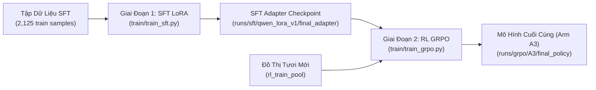

# SỔ TAY HƯỚNG DẪN HUẤN LUYỆN TOÀN DIỆN: SFT LoRA & RL GRPO (TRAINING RUNBOOK)

**Dành cho:** Thành viên nhóm phụ trách huấn luyện mô hình trên GPU  
**Dự án:** *Distill, then Sharpen: Amortizing Evolutionary Heuristic Search into a Family-Conditioned Code LLM*  
**Triết lý cốt lõi:** **"Distill, then Sharpen"**  
- **Giai đoạn 1 (Chưng cất - SFT LoRA):** Dạy mô hình nền `Qwen2.5-Coder-7B-Instruct` học định dạng chữ ký hàm `priority(...)`, tư duy vector hóa NumPy và cơ chế điều kiện hóa theo Text Card trên $2,125$ mẫu train chuẩn.
- **Giai đoạn 2 (Mài sắc - RL GRPO):** Sử dụng thuật toán Group Relative Policy Optimization, mô hình tự rollout trên các đồ thị tươi mới từ `rl_train_pool` (seeds 100000-199999), tự nhận thưởng từ Sandbox và mài sắc chính sách để tiết kiệm màu hơn và chạy nhanh hơn.



---

## 1. Yêu Cầu Phần Cứng & Chi Phí (Hardware & Cloud GPU)

- **VRAM GPU cần thiết:**
  - **Chế độ 4-bit QLoRA (Mặc định trong code):** Chỉ cần **$\ge$ 12 GB VRAM** (RTX 3060 12GB, RTX 3080 12GB, RTX 4070 12GB, RTX 3090, RTX 4090, T4, L4, A100).
  - **Chế độ bfloat16 / fp16:** Cần **$\ge$ 24 GB VRAM** (RTX 3090, RTX 4090, A5000, A100).
- **Nếu máy cá nhân không có GPU rời $\ge$ 12GB:**
  - **Thuê Cloud GPU giá rẻ:** Thuê 1 máy RTX 3090 / 4090 trên [RunPod.io](https://runpod.io) hoặc [Vast.ai](https://vast.ai) với giá **~$0.30 / giờ**.
  - **Thời gian & Chi phí:**
    - Huấn luyện SFT: ~20 phút.
    - Huấn luyện GRPO (100 steps): ~20 phút.
    - **Tổng chi phí toàn bộ quá trình train chỉ khoảng $0.20 – $0.30 ($\approx$ 5,000 – 7,000 VNĐ)!**
  - **Google Colab Pro:** Có thể dùng GPU T4 hoặc A100.

---

## 2. Cài Đặt Môi Trường Huấn Luyện (3 phút)

### Bước 1: Kích hoạt môi trường và cài đặt PyTorch CUDA
Đảm bảo bạn đã cài PyTorch tương thích với CUDA của máy (xem lệnh chuẩn tại [pytorch.org](https://pytorch.org)):
```bash
# Ví dụ cài PyTorch với CUDA 12.1:
pip install torch torchvision torchaudio --index-url https://download.pytorch.org/whl/cu121
```

### Bước 2: Cài đặt các thư viện Fine-tuning & RL
```bash
pip install transformers peft trl bitsandbytes accelerate datasets scipy
```

### Bước 3: Kiểm tra GPU sẵn sàng
```bash
python -c "import torch; print('CUDA Available:', torch.cuda.is_available(), '| Device:', torch.cuda.get_device_name(0) if torch.cuda.is_available() else 'None')"
```
*Kỳ vọng:* Hiển thị `CUDA Available: True` kèm tên card đồ họa.

---

## 3. GIAI ĐOẠN 1: Huấn Luyện Chưng Cất (SFT LoRA)

Mục tiêu: Đưa mô hình từ trạng thái sinh code tự do về trạng thái tuân thủ 100% chữ ký hàm `priority(adj, colors, sat, deg, uncolored_deg)` và hiểu Text Card.

### A. Chạy thử nghiệm giả lập (Mock Mode - Mất 2 giây trên CPU)
Trước khi train thật, bạn có thể chạy thử để chắc chắn script hoạt động trơn tru:
```bash
python train/train_sft.py --mock
```

---

### B. Chạy huấn luyện thật trên GPU (Production Mode)

Chạy dòng lệnh sau:
```bash
python train/train_sft.py \
    --train-path data/sft/train.jsonl \
    --val-path data/sft/val.jsonl \
    --output-dir runs/sft/qwen_lora_v1 \
    --model-name Qwen/Qwen2.5-Coder-7B-Instruct \
    --epochs 2 \
    --lr 1e-4 \
    --batch-size 4
```

- **Các cơ chế tối ưu tích hợp sẵn:**
  1. **4-bit NormalFloat (NF4) QLoRA:** Nén mô hình 7B xuống chỉ chiếm ~5 GB VRAM cơ sở.
  2. **LoRA Rank $r=16, \alpha=32$:** Huấn luyện trên tất cả các ma trận chú ý và feed-forward.
  3. **Gradient Accumulation = 4 & Gradient Checkpointing:** Tương đương effective batch size = 16, đảm bảo hội tụ ổn định mà không lo tràn VRAM.
- **Dấu hiệu hội tụ:** Loss bắt đầu từ $\sim 1.6 \div 1.8$ và giảm đều về $\sim 0.3 \div 0.5$ ở cuối epoch 2.
- **Thời gian huấn luyện:** ~15–25 phút trên RTX 3090/4090/A100.
- **Checkpoint đầu ra:** `runs/sft/qwen_lora_v1/final_adapter/` (Adapter LoRA chỉ nặng ~80 MB).

---

## 4. GIAI ĐOẠN 2: Tinh Chỉnh Tăng Cường (RL GRPO)

Mục tiêu: Dùng thuật toán **Group Relative Policy Optimization (GRPO)** để mài sắc chính sách (Sharpening), thúc đẩy mô hình tìm ra các hàm ưu tiên tiết kiệm màu hơn và chạy nhanh hơn.

### A. Chạy thử nghiệm giả lập (Mock Mode - Mất 5 giây trên CPU)
```bash
python train/train_grpo.py --mock --steps 2
```

---

### B. Chạy huấn luyện thật trên GPU (Production Mode)

Nạp trực tiếp checkpoint SFT vừa huấn luyện ở Giai đoạn 1 để tiếp tục mài sắc:
```bash
python train/train_grpo.py \
    --arm A3 \
    --sft-checkpoint runs/sft/qwen_lora_v1/final_adapter \
    --output-dir runs/grpo/A3/seed_42 \
    --steps 100 \
    --group-size 8
```

- **Cơ chế hoạt động của GRPO:**
  1. **Rollout Group:** Tại mỗi step, mô hình nhận 1 Text Card và tự sinh ra một nhóm $G = 8$ hàm priority khác nhau (với nhiệt độ $T=0.7$).
  2. **Fresh Graph Sampling:** Hệ thống tự động sinh 3 đồ thị tươi mới từ tập `rl_train_pool` (seeds 100000-199999).
  3. **Group Relative Reward:** Đưa cả 8 hàm vào Sandbox chấm điểm trên cùng đồ thị:
     $$r = r_{\text{sav}} - b \cdot r_{\text{time}} + d \cdot r_{\text{div}}$$
     Hàm nào tô ít màu hơn và chạy nhanh hơn sẽ nhận advantage dương để mô hình học theo; hàm lỗi cú pháp hoặc vi phạm sandbox nhận phạt cứng $-1.0$.
- **Thời gian hoàn thành:** Khoảng ~20 phút cho 100 bước mài sắc.
- **Checkpoint đầu ra:** `runs/grpo/A3/seed_42/final_policy/` (Chính sách hoàn thiện cuối cùng của Arm A3).

---

## 5. Đánh Giá Mô Hình Sau Huấn Luyện (Evaluation)

Sau khi hoàn tất cả 2 giai đoạn, bạn chạy script đánh giá để kiểm tra năng lực giải thuật của mô hình trên tập test nội suy (`test_interp`) với cờ khóa test:

```bash
# Đánh giá mô hình SFT (Arm A1):
python eval/eval_model.py \
    --backend hf \
    --model-name runs/sft/qwen_lora_v1/final_adapter \
    --split test_interp \
    --k 8 --n-samples 8 \
    --run-id eval_a1_sft

# Đánh giá mô hình sau khi mài sắc GRPO (Arm A3 - Mô hình cốt lõi của bài báo):
python eval/eval_model.py \
    --backend hf \
    --model-name runs/grpo/A3/seed_42/final_policy \
    --split test_interp \
    --k 8 --n-samples 8 \
    --run-id eval_a3_grpo
```

- **Chỉ số kỳ vọng đạt được:**
  - `valid_rate`: Đạt $\ge 98\%$.
  - `coverage@k`: Tăng mạnh từ SFT lên GRPO (chứng minh tác dụng mài sắc của thuật toán RL).
  - `savings vs R(F)`: Thể hiện số màu tiết kiệm trung bình vượt trội so với các thuật toán tham lam cổ điển.

---

## 6. Xử Lý Sự Cố Thường Gặp (Troubleshooting)

### Q1: Bị lỗi `CUDA out of memory (OOM)` khi chạy SFT?
**Cách xử lý:** 
- Giảm `--batch-size` từ 4 xuống **2** hoặc **1**:
  ```bash
  python train/train_sft.py --batch-size 1 ...
  ```
- Nhờ cơ chế `gradient_accumulation_steps=4`, việc giảm batch size không làm giảm độ hội tụ của mô hình.

### Q2: Bị lỗi `CUDA out of memory (OOM)` khi chạy GRPO?
**Cách xử lý:**
- Giảm `--group-size` từ 8 xuống **4**:
  ```bash
  python train/train_grpo.py --group-size 4 ...
  ```

### Q3: Sau khi train xong thì gửi file nào cho nhóm?
**Cách xử lý:**
Chỉ cần nén thư mục trọng số LoRA:
- Thư mục SFT: `runs/sft/qwen_lora_v1/final_adapter/` (~80 MB)
- Thư mục GRPO: `runs/grpo/A3/seed_42/final_policy/` (~80 MB)  
Cả hai file nén chỉ nặng chưa đầy 150 MB, rất nhẹ để gửi qua Google Drive hoặc Zalo/Telegram!
